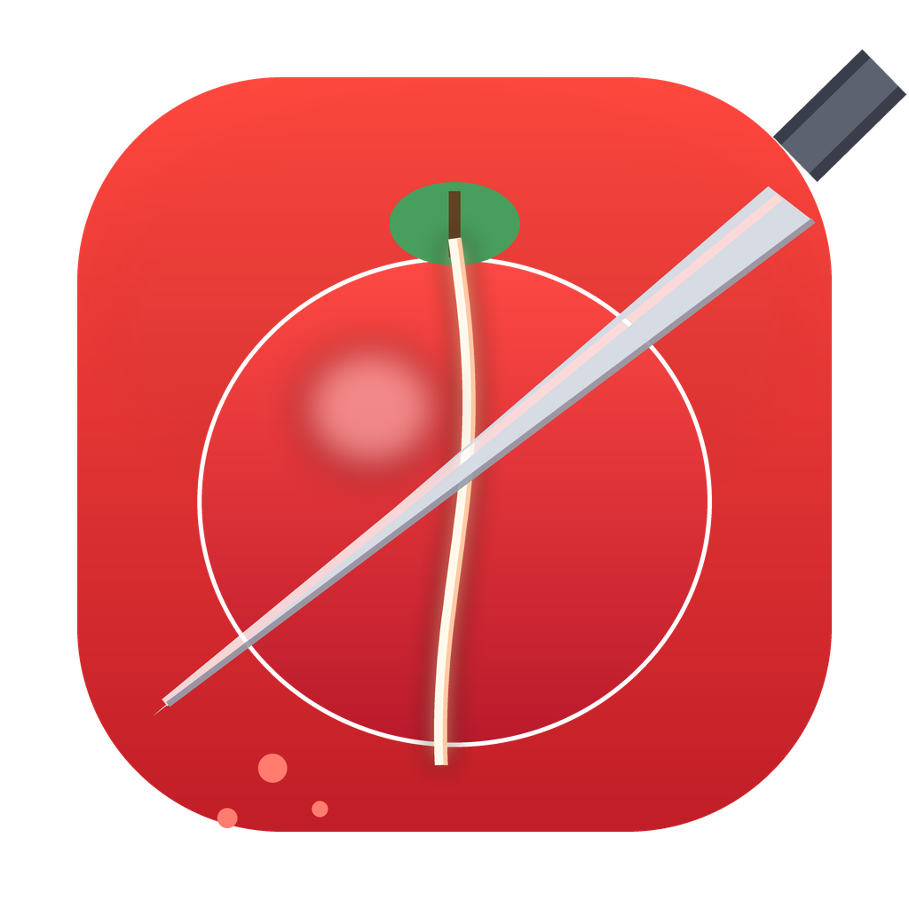

# 水果刀

红果短剧批量下载工具 · 苹果风桌面客户端

一款本地运行的红果短剧搜索 / 解析 / 批量下载工具，界面为自绘的 macOS 风格（无边框窗口、
交通灯按钮、SF 字体栈、层次化浅灰背景）。所有功能均在本地完成，不含任何远程会员 /
支付 / 心跳逻辑。



---

## 功能

| 功能 | 说明 |
|---|---|
| 关键词搜索 | 调用官方搜索接口，支持短剧与漫剧，按热度排序，支持翻页加载 |
| 链接解析 | 粘贴 `novelquickapp.com` 分享链接或 `series_id`，自动提取并抓取剧集列表 |
| 批量下载 | 选择清晰度（360p ~ 1080p）后整剧下载，或展开任务卡片选集下载 |
| 断点续传 | 进度文件驱动，重启后可跳过已完成集次；支持暂停 / 继续 |
| 逐集状态 | 展开卡片可见每集状态网格：灰=待下载、蓝=下载中、绿=完成、红=失败 |
| 封面抓取 | 解析成功自动下载封面图到剧集目录 |

任务卡片支持的操作：开始下载 / 暂停 / 继续 / 重试解析 / 打开网页 / 打开文件夹 / 移除。

---

## 快速开始

### 1. 环境要求

- Windows 10/11 x64
- Python 3.12（签名模块按 3.12 编写；3.13 也可运行）

### 2. 安装依赖

```bash
git clone <this-repo>
cd <this-repo>
python -m venv .venv
.venv\Scripts\activate
pip install -r requirements.txt
```

### 3. 准备 ffmpeg

下载 ffmpeg 并放到 `ffmpeg_bin/ffmpeg-N-*-win64-gpl-shared/bin/`（目录名可任意，
程序按 `ffmpeg_bin/*/bin/ffmpeg.exe` 或 `ffmpeg_bin/bin/ffmpeg.exe` 查找）。
仓库不含该二进制（体积过大），可从 [ffmpeg.org](https://ffmpeg.org/download.html) 获取。

### 4. 运行

```bash
python run.py
```

---

## 打包

```bash
pip install pyinstaller
pyinstaller --noconfirm hongguo.spec
```

产物在 `dist/水果刀/水果刀.exe`。注意：**整个 `dist/水果刀` 目录都要保留**，
`_internal` 内的 ffmpeg 与签名模块是运行期依赖，不能只拷 exe。

---

## 命令行参数

| 参数 | 用途 |
|---|---|
| 无参数 | 正常启动图形界面 |
| `--selftest` | 自检：搜索 → 解析 → 真实下载一集，结果写入 `selftest.log` |
| `--guitest` | 走完整 GUI 流程（填链接 → 解析 → 点击下载），结果写入 `guitest.log` |
| `--uishot <path>` | 启动真实窗口并把界面截图存到 `<path>` |
| `<script.py> <cfg>` | 工作进程模式：执行下载脚本（由 GUI 内部调用，勿手动使用） |

排查问题时优先跑 `--selftest`，它会真实下载一集并给出完整链路日志。

---

## 项目结构

```
run.py                 启动入口（含工作进程分发 / 自检参数）
app/
  main_window.py       主界面（2022 行）：窗口、搜索、任务卡片、下载调度
  batch_downloader.py  下载子进程：签名 → 解密 URL → ffmpeg 解密转封装
  search_index.py      搜索接口封装
  config.py            应用名 / 版本
hg_src/
  1.py                 视频解析端点（Python 版）
  liushen/flurl/       请求签名模块（xgorgon / helios / medusa / sign_proto）
hongguo.spec           PyInstaller 打包配置
```

---

## 实现说明

### 无边框窗口的缩放与最大化

窗口使用 `Qt.FramelessWindowHint`，缩放 / 最大化 / 拖动全部自行实现：

- `_edge_at(gpos)` 判定鼠标是否在 8 个边缘方向，**入参必须是全局坐标**
  （`QMouseEvent.globalPos()`）。若误传局部坐标，右侧与下侧边缘将永远无法命中。
- `_resize_geo` 是「按下鼠标那一刻」的基准矩形，**拖动全程不再更新**。
  若每帧刷新基准、而位移又是相对按下点的累积量，窗口会越拖越快、失控漂移。
- 最小尺寸 940×620；最大化铺满工作区但不覆盖任务栏；双击标题栏可切换。

### 打包后的子进程

PyInstaller 打包后 `sys.executable` 指向 GUI 程序自身，直接
`Popen([exe, "batch_downloader.py", cfg])` 不会执行脚本、而是又开一个界面。
`run.py` 因此识别「第一个参数是 `.py`」的情况，用 `runpy` 在当前进程内执行下载脚本。
若在冻结产物上验证下载，请用 `--selftest` / `--guitest`，不要只测源码模式。

### 任务卡片的鼠标事件

`TaskCard.mousePressEvent` 不要调用 `super().mousePressEvent(e)` ——
那会把按下事件重新派发给子控件，导致「开始下载」按钮被连点两次
（第一次启动、第二次立刻暂停），表现为点击后状态卡在「暂停」。

### 下载任务的进度文件

`_on_download_all`（手动点「开始下载」走的路径）必须在函数内自行拼出
`progress_file`，不能复用 `task._pf` —— 该字段在此刻仍为空串，
会让子进程 `open('', 'w')` 抛 `FileNotFoundError`。

---

## 环境变量（可选）

| 变量 | 默认值 | 说明 |
|---|---|---|
| `DUANJU_DEVICE_ID` | `11223344556677889900` | 设备号 |
| `DUANJU_INSTALL_ID` | `99887766554433221100` | 安装号 |

---

## 免责声明

本项目仅供学习交流与个人使用。使用者需自行确保其行为符合所在地法律法规、
内容平台服务条款及相关版权规定。请勿用于批量抓取、传播或商业分发受版权保护的内容，
下载的内容请仅供个人欣赏。

---

## License

Private / All rights reserved.
